# Code & Remediation Agent, Coordinator Synthesis and Policy Gate (P3)

**Owner:** P3 (Bayyapureddy Vibhugnan). One document for everything P3 owns: the shared
evidence contract, the Code agent, the Coordinator's synthesis, the remediation engine,
the OPA policies, the gated path to a draft pull request, the approval contract, the
audit layer and the Week 8 evaluation. Other docs go deeper on one piece and are linked
where relevant.

---

## 1. Where P3 sits in the system

```mermaid
flowchart LR
    J[Jenkins build fails] --> B[Backend webhook]
    B -->|incident.created| C[Coordinator<br/>Google ADK]
    C -->|A2A task| JA[Jenkins agent P1]
    C -->|A2A task| MA[Metrics agent P2]
    C -->|A2A task| CA[Code agent P3]
    JA & MA & CA -->|evidence| BB[(Blackboard)]
    BB --> S[Synthesis P3<br/>one incident report]
    S --> R[Remediation engine P3<br/>minimal fix]
    R --> G1{Remediation policy<br/>OPA}
    G1 -->|allowed| REG[POST /remediations]
    REG -->|approval.requested| N[Notifier P1] --> H[Human reviewer]
    H -->|POST /approvals| D[approval.decided]
    D --> G2{Pull-request policy<br/>OPA}
    G2 -->|allowed| PR[Draft PR on<br/>ai-fix/incident-attempt]
    PR --> V[Jenkins re-validates] -->|SUCCESS| RES[RESOLVED]
    V -->|FAILURE| RI[re-investigate / escalate]
```



Everything P3 owns is boxed "P3" or is a gate. The agents never call each other: each
writes one evidence document to the blackboard and announces it; only the Coordinator
reads them all.

| Component | Code | Tests |
| --- | --- | --- |
| Evidence contract | `common/models.py`, `common/evidence_schema.json` | `tests/common/test_evidence_schema.py` |
| Code agent | `agents/code_agent/` | `tests/code_agent/` |
| Synthesis | `coordinator/synthesis.py`, `coordinator/agent.py` | `tests/coordinator/test_synthesis*.py` |
| Remediation engine | `agents/code_agent/remediation.py` | `tests/code_agent/test_remediation.py` |
| Policies | `policies/remediation.rego`, `policies/pull_request.rego` | `policies/*_test.rego` (26 Rego tests) |
| Remediation gate | `coordinator/remediation_gate.py` | `tests/coordinator/test_remediation_gate.py` |
| Live remediation loop | `coordinator/remediation_service.py`, `backend/routes/remediations.py` | `tests/integration/test_remediation_loop.py`, `tests/test_backend_remediations.py` |
| Approval contract | `backend/routes/approvals.py`, `approvals` table | `tests/test_backend_approvals.py` |
| Fix-branch naming | `common/fix_branch.py` | `tests/common/test_fix_branch.py` |
| Audit layer | `common/audit.py`, `backend/db/audit_models.py`, `migrations/` | `tests/common/test_audit.py`, `tests/test_audit_migration.py` |
| Evaluation | `scripts/evaluate_remediation.py` | `tests/scripts/test_evaluate_remediation.py` |

## 2. The evidence contract

Every agent writes one `Evidence` document per incident (`common/models.py`). The JSON
Schema in `common/evidence_schema.json` is generated from the model by
`scripts/generate_evidence_schema.py --check`, and a test fails if the two differ.

* `failure_type` comes from a fixed 11-class taxonomy (`FailureTaxonomy`); there are no
  aliases. `unknown` may never be asserted above 0.4 confidence.
* Every hypothesis must cite evidence item ids that exist in the same document.
* Optional, additive fields: `investigation_coverage` and `coverage_notes` (P2), and
  `related_incident_ids` and `recurrence_count` for duplicate linking (TC-19).
* `redaction_applied` must be true to be stored, and the store redacts again on write,
  because the flag is a claim, not proof.

## 3. The Code agent

A CrewAI `Flow` (`agents/code_agent/agent.py`) with four steps:

1. **fetch_context** - reads the failing commit, its pull requests and recent branch
   history from GitHub (read-only client, bounded timeouts and retries).
2. **analyze** - classifies every changed path by role (dependency manifest,
   configuration, CI pipeline, deployment, test, source, documentation) and extracts
   dependency pins and configuration values that moved (`diff_analysis.py`).
3. **reason** - ranks code-side causes with confidence and cited evidence
   (`reasoning.py`).
4. **finalize** - writes the evidence document and the audit trail, and announces
   `evidence.ready` over A2A.

### Why it has no LLM

A diff is already structured data. Rules give the same answer every time, every verdict
points at the rule that fired, every rule has tests, and nothing can be invented. An LLM
would add variance and a failure mode (a plausible but wrong cause) without adding
information the diff does not already contain.

### Restraint rules

| Rule | Behaviour | Case |
| --- | --- | --- |
| Absence of evidence | Empty or documentation-only commit: "a code change does not explain this failure", `unknown` at <= 0.4 | TC-12 |
| Competing explanations | A commit that moves a pin and edits many files scores lower | TC-13 |
| Confidence floor | Below 0.5: `insufficient_evidence`, asks for correlation | TC-14 |
| Humble unknown | `unknown` is capped at 0.4 | all |

A configuration value only counts as broken if the change is checkably wrong: it was
removed or emptied, changed type, a positive quantity (timeouts, ports, sizes, retries,
workers, replicas, threads, pools...) went to zero or below, or a URL lost or changed
its scheme. A plausible change (a timeout from 3 to 30) is named as the likely cause but
is never reverted automatically.

## 4. Synthesis: one report from three agents

`coordinator/synthesis.py` fuses whatever evidence is on the blackboard into one
`IncidentReport`:

* Each agreeing agent adds 0.1 confidence; a conflict costs 0.15; two causes within
  0.10 are reported as a tie.
* Fused confidence is capped at 0.95, because agents can share a blind spot.
* A report is **actionable** only if it is resolved, not `unknown`, at least 0.5, and
  complete (no missing or failed agent). The same 0.5 is in the code agent and in the
  Rego, and tests keep the three equal.
* An abstaining agent is listed, never counted as a vote.
* A recurrence (TC-19) is shown with the linked earlier incidents and a count; the
  database keeps `incidents.related_incident_id`.

## 5. The remediation engine

`propose_fix(report, files, base_ref, attempt)` returns a `FixPlan` or a `NoFix` with
its reason. A fix is proposed only for an actionable report of a dependency regression
or a configuration error, because only those carry a provable previous good state in
the diff:

* **The fix is the inverse of the breaking line.** The removed line from the commit
  that broke the build replaces the added one, verbatim. Nothing else is touched.
* Each `FileEdit` must match exactly one line when applied, or it is refused
  (`EditNotApplicable`), so a stale fix can never land somewhere unintended.
* The branch is `ai-fix/<incident_id>-<attempt>` (`common/fix_branch.py`), which the
  `FixPlan` validator enforces, so Jenkins' re-validation run links back to the incident
  and attempt by its name alone.

## 6. Three gates, all failing closed

| Gate | When | What it checks |
| --- | --- | --- |
| 1. `policies/remediation.rego` | before any human sees the fix | confidence >= 0.5; at most 5 files and 40 changed lines; only `target_app/**`; never the Jenkinsfile, CI, monitoring, migrations, Dockerfiles or the policies; never a secret path; never deletes a test or adds a skip, xfail, `verify=False` or a disabled check; never a "pass" bought by dropping tests |
| 2. A named human | after gate 1 | approve or reject, recorded once per attempt in `approvals` |
| 3. `policies/pull_request.rego` | before the branch is created | gate 1 passed, a named reviewer approved, the PR is a draft, auto-merge is off |

If OPA cannot answer, the answer is no. The PR is always a draft; no code path enables
auto-merge, and the policy refuses it anyway. GitHub writes use a separate client
(`GitHubWriter`) from the read-only one and are never blindly retried, so one approval
can never open two pull requests.

## 7. The live loop

`coordinator/remediation_service.py` connects the gates to the running system:

1. After every report revision, `on_report` proposes a fix for an actionable report,
   runs gate 1, stores the plan under `data/remediations/<incident>/a<attempt>.json`,
   and registers it with `POST /remediations`. The backend stores the proposal and its
   verdict and, if allowed, publishes `approval.requested`; the notifier (P1) sends the
   Slack/Teams/email request with signed links.
2. The reviewer decides on the review page, a signed link or the UI. The backend records
   it (`approvals`) and publishes `approval.decided`.
3. The Coordinator consumes `approval.decided`; `on_decision` runs gates 2 and 3, creates
   the branch, opens the draft PR and reports it with `PATCH /remediations/...`.
4. Jenkins builds the `ai-fix/...` branch and calls the re-validation webhook, which
   resolves the incident (TC-18), or records the failure and re-investigates, escalating
   when attempts run out (TC-17).

Every step is idempotent per `(incident_id, attempt)`: a plan is proposed once, a
reviewer asked once, a decision applied once, however often a revision lands or a
message is redelivered. If the backend is down, the plan is kept and the next revision
retries the registration without re-running policy.

**Configuration** (Coordinator): `GITHUB_TOKEN`, `GITHUB_REPO`, `OPA_URL`, `BACKEND_URL`,
`APPROVAL_API_TOKEN`. If any is unset, remediation is disabled and investigation runs
as before. `REMEDIATION_ENABLED=0` disables it explicitly.

## 8. Audit and secrets

* Five append-mostly tables: `audit_events`, `agent_runs`, `remediation_proposals`,
  `policy_decisions`, `approvals` (migrations `0001`, `0002`).
* `AuditRecord` redacts its own summary and payload, at any depth.
* Redaction (`common/redaction.py`) masks bearer tokens, credentials in URLs,
  `password=`/`token:`-style assignments, GitHub tokens, AWS keys, Google API keys and
  Slack tokens. TC-20 is tested for seven kinds of fake secret across the audit trail,
  evidence store, blackboard and the code agent end to end
  (`tests/security/test_tc20_secret_redaction.py`).

## 9. Test-case coverage

| TC | Scenario | Where it is shown |
| --- | --- | --- |
| TC-03 | Dependency regression | `scenarios/tc03_*.yaml`, demo, evaluation E01-E04, integration loop |
| TC-08 | Configuration error | `scenarios/tc08_*.yaml`, evaluation E05-E08 |
| TC-11 | Deployment failure / draft PR | evaluation E09, `test_remediation_gate.py`, integration loop |
| TC-12 | Anomaly without a code change | `scenarios/tc12_*.yaml`, demo, evaluation E10-E11 |
| TC-13 | Multiple signals | `test_reasoning.py` (competing explanations) |
| TC-14 | No clear root cause | `scenarios/tc14_*.yaml`, evaluation E12, policy P14 |
| TC-15 | Unsafe fix | demo, policies P03-P07, PR policy R06, `test_backend_remediations.py` |
| TC-16 | Human rejects | demo, `test_backend_approvals.py`, integration loop |
| TC-17 | Fix validation failure | `tests/test_tc17_tc18_fix_validation.py`, policy P16 |
| TC-18 | Successful remediation | `tests/test_tc17_tc18_fix_validation.py`, integration loop |
| TC-19 | Duplicate incident | demo, `test_synthesis*.py` |
| TC-20 | Secrets exposure | `tests/security/test_tc20_secret_redaction.py`, evaluation E15 |

## 10. Evaluation (Week 8)

`python scripts/evaluate_remediation.py` runs 15 commits, 16 remediation proposals and
7 pull-request requests through the real pipeline; full results are in
[`results/remediation_eval.md`](../results/remediation_eval.md).

| Metric | Agent | Blame the latest commit |
| --- | --- | --- |
| Root-cause accuracy | 100% | 80% |
| Abstained when the commit was innocent | 100% | 0% |
| False-blame rate | 0% | 100% |
| Fix precision | 100% | 50% |
| Unnecessary-fix rate | 0% | 86% |
| Unsafe remediations blocked | 100% | - |
| Gate fails closed without OPA | yes | - |
| Secret leaks | 0 | - |

**Calibration.** ECE 0.21 and Brier 0.058: the agent is *under*-confident (average 0.73
when right, and it was never wrong here), by design - single-source code evidence is
capped below the fused confidence. One tuning change came out of the evaluation (E09,
`replicas` as a positive quantity) and is recorded in the report's tuning log.

**Threats to validity.** The cases were written by the rules' author, so a perfect score
shows consistency more than generality; the Jenkins and metrics evidence is recorded;
15 commits is a small sample; the baseline is deliberately naive (the strawman the
research question names).

## 11. Running it

```bash
python scripts/get_opa.py                    # once: the pinned, checksum-verified opa
python -m pytest -q                          # everything
python scripts/demo_p3.py                    # five scenarios, in the terminal
python scripts/run_ui_demo.py                # the same five in the web UI, no Docker
python scripts/evaluate_remediation.py       # the Week 8 evaluation
```

See [`p3_demo.md`](p3_demo.md) for presenting, [`draft_pr_workflow.md`](draft_pr_workflow.md)
for the Jenkins side of the draft PR, and [`decisions.md`](decisions.md) for the team
contract.

## 12. Known limitations

* Fixes cover dependency regressions and checkably-broken configuration only; logic
  errors and failing tests are diagnosed but always left to a human.
* The code agent sees the failing commit and recent history, not program behaviour.
* The live loop has been tested in-process end to end; a run on the full Docker stack
  with a real GitHub repository has not been recorded yet.
