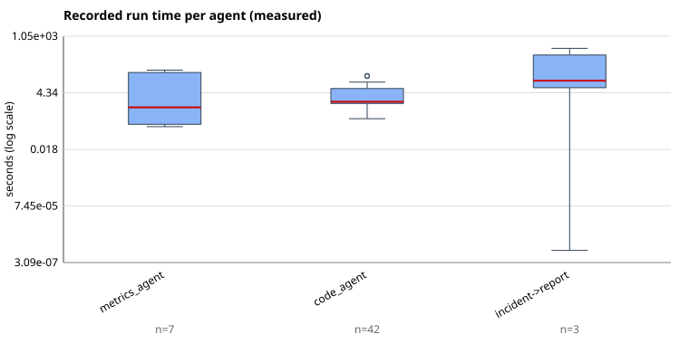
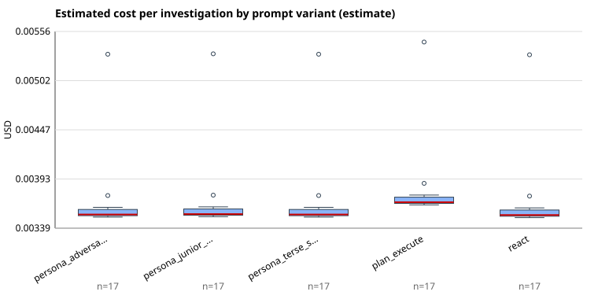
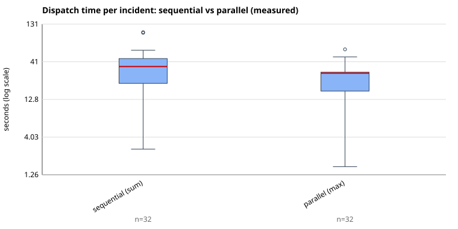

# End-to-end performance evaluation

_Generated 2026-11-18 14:04 UTC by `scripts/evaluate_performance.py`. Replayed from recorded data: **no LLM was called**._

Every number is labelled **measured** (timed on real runs or by running the real code on recorded inputs) or **estimated**
(computed from prompt sizes and an assumed price table). Do not read an estimate as a measurement.

## A. Recorded runs on the real stack (measured)

48 incidents in the audit trail; 0 runs with no end event (a crashed process) are excluded, not counted as fast.

Run time in **seconds**, from the agent starting to the agent finishing:

| Group | n | min | median | p95 | max | mean |
|---|---|---|---|---|---|---|
| code_agent | 42 | 0.35 | 1.83 | 12.23 | 22.55 | 4.70 |
| metrics_agent | 7 | 0.16 | 1.06 | 36.52 | 38.81 | 14.65 |

> The Jenkins agent writes no audit events (the audit check is told to expect that), so its run time is **not** in this table.

Incident opened to first Coordinator report, seconds:

| Group | n | min | median | p95 | max | mean |
|---|---|---|---|---|---|---|
| incident -> report | 3 | 0.00 | 14.13 | 292.41 | 323.33 | 112.49 |

Tool-call latency, **milliseconds**:

| Group | n | min | median | p95 | max | mean |
|---|---|---|---|---|---|---|
| code_agent | 126 | 321.46 | 465.20 | 1674.56 | 21759.27 | 969.34 |
| metrics_agent | 32 | 3.54 | 9.11 | 364.36 | 827.41 | 69.02 |

## B. Coordinator replay (measured)

The recorded evidence of 80 incidents (24 directories skipped) was fused 5 times each by the real `synthesize`.

| Group | n | min | median | p95 | max | mean |
|---|---|---|---|---|---|---|
| synthesize (ms) | 400 | 0.039 | 0.099 | 0.210 | 0.617 | 0.105 |

Verdict identical on every repeat for every incident: **yes**.

## C. Rule path replay (measured)

17 recorded build logs through the real Jenkins-agent parser and classifier, 5 times each.

| Group | n | min | median | p95 | max | mean |
|---|---|---|---|---|---|---|
| parse + classify (ms) | 85 | 0.055 | 0.485 | 29.388 | 37.537 | 2.842 |

Accuracy on the 6 labelled logs: **6/6**.

## D. Prompt variants (ESTIMATED, no LLM called)

85 estimated runs = 5 prompt variants x 17 build logs.
Assumptions (change them with flags): 3 model turns per investigation, 400 output tokens per turn, 0.3 USD per 1M input tokens, 2.5 USD per 1M output tokens, 4 characters per token.

Estimated cost of one investigation, **USD**:

| Group | n | min | median | p95 | max | mean |
|---|---|---|---|---|---|---|
| persona_adversarial | 17 | 0.00351 | 0.00354 | 0.00406 | 0.00531 | 0.00366 |
| persona_junior_dev | 17 | 0.00351 | 0.00354 | 0.00406 | 0.00531 | 0.00367 |
| persona_terse_sre | 17 | 0.00351 | 0.00354 | 0.00406 | 0.00531 | 0.00366 |
| plan_execute | 17 | 0.00364 | 0.00367 | 0.00420 | 0.00544 | 0.00380 |
| react | 17 | 0.00350 | 0.00353 | 0.00405 | 0.00530 | 0.00366 |

## E. Sequential vs parallel dispatch (measured)

The Coordinator runs its three agents in parallel. For 32 real incidents with all three timed (0 skipped as incomplete), a sequential Coordinator would have waited for the **sum** of the three; the parallel one waits for about the **slowest**.

| Group | n | min | median | p95 | max | mean |
|---|---|---|---|---|---|---|
| sequential (sum), s | 32 | 2.79 | 35.38 | 77.15 | 101.90 | 36.19 |
| parallel (max), s | 32 | 1.62 | 28.84 | 40.52 | 60.06 | 24.48 |
| time saved, s | 32 | 1.17 | 6.38 | 35.66 | 52.32 | 11.71 |

Slowest agent per incident: code_agent 2, jenkins_agent 6, metrics_agent 24.

Caveat: the times were recorded while the agents ran in parallel, so a real sequential run could differ a little (no shared load),
and the saving is bounded by the slowest agent: if one agent dominates, parallelism helps less than the sum suggests.

## What this does and does not show

- Parts A-C are timings of real code on real or recorded inputs. They show the pipeline outside the LLM is fast (milliseconds); the
  seconds in part A are dominated by the agents' tool calls and, for the Jenkins agent, by the LLM and Jenkins itself.
- Part D estimates cost from the size of what would be sent. **LLM latency and the accuracy of each prompt variant are not measured**:
  that needs a live run per variant (`PROMPT_VARIANT=<name>` with `scripts/evaluate_jenkins_agent.py`), which this script was written to avoid.
- Nothing writes `llm_call` events yet, so the audit trail holds no measured token counts to replay; once it does, replace part D with them.
- The prompt variants share almost all of their text, so the estimated cost differs mostly across build logs, not across variants. That is
  itself the finding: the persona is cheap, the log is what costs money.
